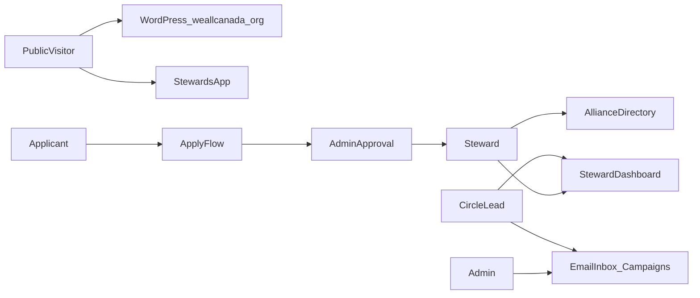
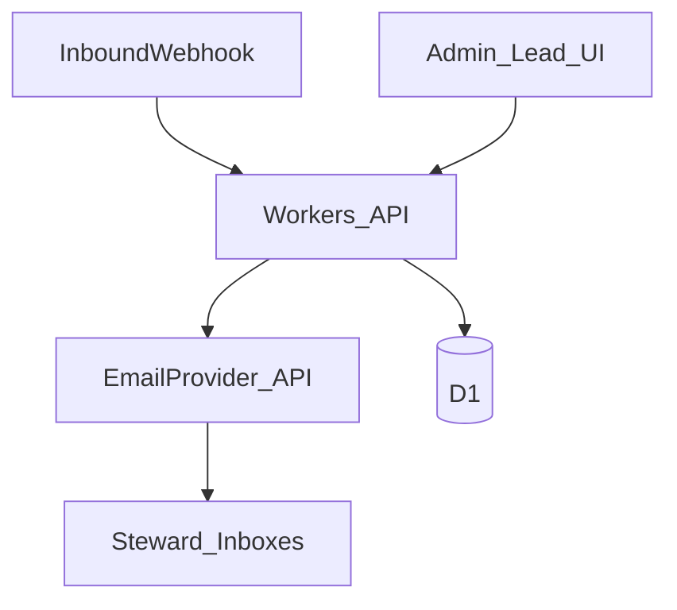

# Architecture: WeAll Canada Stewards Platform

Nov 11, 2026 · Draft — reconcile with Platform Architecture PDF/Miro when a readable export is available.

Related: [STEWARD_PRD.md](STEWARD_PRD.md), [DESIGN.md](DESIGN.md), [DEV_PLAN.md](DEV_PLAN.md), template ops [PRD.md](PRD.md).

## Context



- **Marketing site:** [weallcanada.org](https://weallcanada.org/) (WordPress today).
- **Stewards app:** this Astro + Cloudflare Workers + D1 repo, target entry `weallcanada.org/stewards`.
- **Ops model:** non-technical editors talk to an agent; tech stewards share GitHub/operator duties ([AGENTS.md](AGENTS.md)).

## Routing recommendation

| Option | Pros | Cons |
| --- | --- | --- |
| **A. Path `/stewards` on weallcanada.org** | Matches product intent; one domain | Needs Cloudflare (or similar) in front of WordPress + Worker path rules; WordPress must not own `/stewards` |
| **B. Subdomain `stewards.weallcanada.org`** | Clean Worker hostname; simpler DNS | Not the preferred URL shape; cookies/auth across apex need care |
| **C. Staging on `*.workers.dev` until cutover** | Fast for prototype testing | Temporary; enable Cloudflare Access |

**Default for prototype:** ship on Workers staging URL first (**C**), design all routes under a `/stewards` base path so cutover to **A** is mostly DNS/proxy. Prefer **A** for production if Cloudflare can sit in front of the existing zone; fall back to **B** if WordPress hosting blocks path routing.

Tech stewards own DNS, WordPress exclusion of `/stewards*`, and TLS.

## Stack decision

**Stay on** Astro + `@astrojs/cloudflare` + D1 + existing `npm run start` / `ship` / staging→main flow.

| Concern | Approach | Likely cost |
| --- | --- | --- |
| App hosting | Cloudflare Workers | Free tier first |
| Database | D1 (separate staging/prod) | Free tier; watch row reads |
| Auth | See below | Free–low paid |
| Transactional + broadcast email | External provider (Resend, Postmark, or similar) | Ask before enabling campaigns at volume |
| Spam on public forms | Turnstile + `FORM_LIMITER` ([src/lib/protect.ts](src/lib/protect.ts)) | Free |
| Knowledge Commons LLM / vectors | Later; Workers AI or external | Likely paid — ask |
| File uploads | R2 when needed | Free tier then paid |

If a requirement clearly cannot fit Workers CPU/time or D1 (e.g. heavy sync IMAP at scale), document an escape hatch (Queue + scheduled Worker, or a small dedicated service) rather than abandoning the stack wholesale.

## Auth (chosen default)

**Default for prototype:** session-based auth stored in D1, with:

1. **Email + password** (hashed; never store plaintext).
2. **Google OAuth** (Google Cloud OAuth client; secrets via `wrangler secret`).

Prefer a small, Workers-friendly library pattern (e.g. Auth.js on the Cloudflare adapter **or** Lucia-style sessions in D1). Final library choice can follow the sample repo once linked; do not introduce a second user table later.

**Rules:**

- Unapproved applicants cannot access steward routes.
- Role checks on every privileged API route (not only in the UI).
- Fail closed when auth secrets are missing.

### Alternatives (ranked)

1. **Custom / Lucia + D1 + Google** — full control, fits free tier; more build work.
2. **Auth.js (Auth) on Cloudflare** — faster OAuth wiring; watch edge adapter maturity.
3. **Clerk / similar SaaS** — fastest UX; recurring cost; ask before adopting.

## Roles and permissions

| Capability | Public | Applicant | Steward | Circle lead | Admin |
| --- | --- | --- | --- | --- | --- |
| View public steward landing | yes | yes | yes | yes | yes |
| Apply | yes | — | — | — | — |
| Sign in | — | limited | yes | yes | yes |
| Edit own profile / prefs | — | — | yes | yes | yes |
| Directory + profiles (per privacy) | — | — | yes | yes | yes |
| Dashboard | — | — | yes | yes | yes |
| Approve applicants | — | — | — | — | yes |
| Manage users / roles | — | — | — | — | yes |
| Alliance email inbox | — | — | — | yes* | yes |
| Send campaigns | — | — | — | yes* | yes |

\*Circle lead email access is limited to agreed scopes (own circle / shared inbox policies — finalize when PDF roles are reconciled).

**Tech steward** is a GitHub/org role: may edit operator-owned files, set secrets, merge to production. Not granted by the app DB alone.

## Domain model (Phase A detailed)

All SQL lives in [src/lib/db.ts](src/lib/db.ts). Schema changes = **new** migrations only; index every `WHERE`/`JOIN` column in the same migration.

### Core

- **users** — id, email, password_hash (nullable if Google-only), google_sub, status (`applicant` \| `active` \| `disabled`), created_at
- **profiles** — user_id, display_name, bio, location, avatar_url, partner_org, visibility fields, updated_at
- **preferences** — user_id, privacy_*, comms_email, comms_digest, etc.
- **roles** / **user_roles** — `steward`, `circle_lead`, `admin` (multi-role allowed)
- **applications** — user_id or email, answers JSON, status (`pending` \| `approved` \| `rejected`), reviewed_by, reviewed_at

### Connecting (thin for Phase A)

- **connections** — from_user_id, to_user_id, strength, note, updated_at
- **messages** (in-app) — thread_id, from_user_id, body, created_at  
  Existing sample `messages` table in this starter is a contact-form demo — **rename or replace carefully** via new migrations so steward messaging is not confused with public contact spam.

### Email

- **email_threads** — external_thread_id, subject, status, last_message_at
- **email_messages** — thread_id, direction, from_addr, to_addrs, body_html/text, admin_user_id, provider_id, created_at
- **email_campaigns** — name, subject, body, segment_filter, status, created_by, stats JSON
- **email_campaign_recipients** — campaign_id, user_id/email, status, events

### Later (Phase B stubs OK)

- circles, circle_members, events, resources, decisions, knowledge_docs, embeddings metadata

## Email subsystem



- Inbound: provider webhook → verify signature → store → cluster by thread.
- Outbound reply / campaign: API checks role → provider send → store provider IDs for analytics.
- Campaigns require explicit confirmation with recipient count.
- Without provider secrets, UI shows setup state; do not silently no-op sends in production.

## Application structure (this repo)

```
src/pages/           # public + steward UI (prefer /stewards/* base)
src/pages/api/       # Workers API routes
src/lib/db.ts        # only place for SQL
src/lib/protect.ts   # Turnstile + rate limit for public POSTs
src/styles/tokens.css  # design tokens (see DESIGN.md) — to be added in build
migrations/          # additive D1 migrations
seed/                # local + staging sample data
```

Agent-editable (per AGENTS.md): `src/`, new `migrations/`, `seed/`, `tests/`, `TESTS.md`, `TODO.md`.  
Tech steward / operator: auth secrets, `wrangler.jsonc`, workflows, DNS, WordPress, email provider.

## Security

- Public writes: `checkSubmission` + Turnstile.
- Authz on every privileged route.
- Separate D1 for staging vs production.
- Staging behind Cloudflare Access (open TODO from Al).
- Never print `.dev.vars`.
- Activity audit / admin undo: Phase B stretch.

## PWA

- Web app manifest + icons; service worker scoped to the stewards origin/path.
- Desktop-first layouts; mobile usable; “Add to Home Screen” must work on iOS/Android browsers that support it.

## PDF / Miro reconciliation checklist

When a readable architecture export arrives, update this doc for:

- [ ] Exact role names and inheritance
- [ ] Circle permission matrix
- [ ] Entity list vs names above
- [ ] Email access rules for leads
- [ ] Any mandated third-party systems

## Sample repo / Festival follow-up

Prior platform reference (different stack — Next.js + Supabase):

- GitHub: https://github.com/nynysaf/Festival (private)
- Local: `C:\Users\narya\OneDrive\Documents\WEAll Can\Festival`
- Blueprints: `PROJECT_REFERENCE.md`, `architecture.md`, `design_style.md`

**Reuse as product/patterns, not as visual or stack copy:** directory, messaging/connections, Resend email/campaigns, role consoles, onboarding survey ideas. Rebuild on Astro + Workers + D1. Visual system stays [DESIGN.md](DESIGN.md) / weall.org — Festival’s “Playful Geometric” (violet/pink) is a separate event brand.

### WeAll Canada sociocracy circles (product)

- Central Circle (active)
- Knowledge Building (active)
- Policy (active)
- Liberating Tools (active)
- Grassroots (dormant)

Colour/mark rules: [DESIGN.md](DESIGN.md) circle system.
